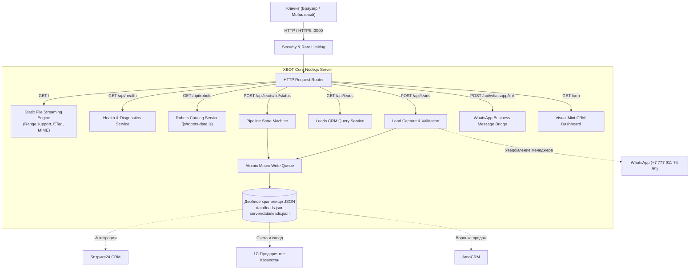

# Серверная архитектура и REST API — XBOT Robotics Kazakhstan

Официальная серверная платформа для дистрибуции робототехники **Unitree** и **PUDU** в Республике Казахстан (ТОО «XBOT», г. Алматы / г. Астана).

Архитектура спроектирована по стандарту **Zero-Dependency Core**: сервер работает на встроенных модулях Node.js (`http`, `fs/promises`, `path`, `crypto`), запускаясь мгновенно без `npm install` и внешних тяжелых зависимостей.

---

## 1. Архитектурный обзор



### Ключевые преимущества:
1. **Zero External Dependencies**: ни одного внешнего пакета в рантайме. Исключены риски уязвимостей в цепочке поставок (supply chain attacks).
2. **Атомарная сохранность данных (Data Resilience)**: запись заявок выполняется через неблокирующую очередь (Mutex Queue) во временный файл с последующим атомарным системным вызовом `rename`. Файлы `data/leads.json` и `server/data/leads.json` зеркалируются и никогда не повреждаются при сбоях питания.
3. **Безопасность (Security Hardened)**:
   - Встроенный скользящий Rate Limiter (защита от спама и DoS-атак на форму).
   - Защита от Path Traversal (`../`) при раздаче статических файлов.
   - Ограничение размера входящего payload до 1 МБ.
   - Заголовки безопасности: `X-Content-Type-Options: nosniff`, `X-Frame-Options: SAMEORIGIN`, `Referrer-Policy: strict-origin-when-cross-origin`, CORS.
4. **Стриминг медиа и PDF**: поддержка заголовка `Range: bytes=...` (HTTP 206 Partial Content) для комфортного чтения 400+ КБ официального каталога PUDU & Unitree с мобильных устройств.
5. **Встроенная панель менеджера (/crm)**: оперативный веб-интерфейс для отдела продаж в Казахстане со статусами воронки, поиском и кнопками прямого перехода в WhatsApp клиента.

---

## 2. Структура проекта

```
robot-kz/
├── server/
│   ├── server.js              # Основной HTTP-сервер и маршрутизатор API
│   ├── crm.html               # Встроенный дашборд CRM для менеджеров
│   ├── test-api.js            # Автоматизированный тест-сьют API (Node.js)
│   ├── README.md              # Документация архитектуры и интеграций
│   └── data/
│       └── leads.json         # Зеркало базы данных заявок
├── data/
│   └── leads.json             # Основная база данных заявок (JSON)
├── js/
│   ├── robots-data.js         # База 39 моделей Unitree и PUDU (UMD экспорт)
│   └── app.js                 # Фронтенд-логика с интеграцией POST /api/leads
├── css/
│   └── style.css              # Стили интерфейса и адаптивность
├── assets/                    # Оптимизированные WebP изображения роботов
├── index.html                 # Главный лендинг и каталог
├── catalog_pudu_unitree_extended.pdf  # Официальный PDF-каталог
├── package.json               # Скрипты запуска и метаданные проекта
└── tests/
    └── run_tests.py           # Полный QA тест-сьют (Python 3 + Node.js)
```

---

## 3. Спецификация REST API

### Базовый URL
- Локально: `http://localhost:3000`
- API префикс: `/api`

### Таблица эндпоинтов

| Метод | Путь | Описание | Формат тела |
|---|---|---|---|
| `GET` | `/api/health` | Проверка здоровья, аптайма и метрик | — |
| `GET` | `/api/robots` | Каталог всех 39 моделей роботов | Query params |
| `POST` | `/api/leads` | Регистрация новой заявки клиента с сайта | JSON |
| `GET` | `/api/leads` | Выгрузка списка лидов для CRM-систем | Query params |
| `POST` | `/api/leads/:id/status` | Смена статуса заявки в воронке | JSON |
| `POST` | `/api/whatsapp/link` | Генерация ссылки WhatsApp с текстом | JSON |
| `GET` | `/crm` | Дашборд управления лидами для менеджеров | HTML |

---

### Подробное описание эндпоинтов

#### 1. `GET /api/health`
Возвращает статус сервера, аптайм, локальное время Алматы и статистику заявок.

**Пример ответа (200 OK):**
```json
{
  "status": "ok",
  "service": "XBOT Robotics Kazakhstan API",
  "version": "1.0.0",
  "uptime": 128.45,
  "uptimeSeconds": 128,
  "environment": "production",
  "timestamp": "2026-11-05T14:30:00.000Z",
  "almatyTime": "05.11.2026, 19:30:00",
  "memoryUsageMB": 42.15,
  "stats": {
    "totalLeads": 14,
    "newLeads": 3,
    "activeRobots": 39
  }
}
```

---

#### 2. `GET /api/robots`
Отдает полный каталог моделей из `js/robots-data.js`.

**Параметры строки запроса (Query Params):**
- `slug` — получение конкретной модели (например, `?slug=go2-pro`).
- `brand` — фильтрация по бренду (`unitree` или `pudu`).
- `category` / `cat` — фильтрация по категории (`quadruped`, `humanoid`, `cleaning`, `delivery`, `components`).
- `search` / `q` — поиск по названию, описанию и характеристикам.

**Пример ответа (200 OK):**
```json
{
  "status": "ok",
  "success": true,
  "total": 39,
  "count": 39,
  "robots": [
    {
      "slug": "go2-pro",
      "name": "Unitree Go2 Pro",
      "desc": "Go2 с 4G, голосовым управлением и системой сопровождения ISS 2.0",
      "brand": "Unitree",
      "cat": "quadruped",
      "cat_name": "Четвероногие роботы",
      "image": "assets/cards/ph-go2-pro-1.webp",
      "price_kzt": 1450000,
      "price_label": "1 450 000 ₸",
      "lease_label": "от 72 000 ₸/мес",
      "specs": {
        "Скорость": "до 3.7 м/с (13.3 км/ч)",
        "Сенсоры": "4D-LiDAR L1 360°x90°",
        "Интеллект": "GPT-ИИ голосовой диалог",
        "Связь": "4G eSIM + Wi-Fi 6 + Bluetooth"
      }
    }
  ]
}
```

---

#### 3. `POST /api/leads`
Создает новую заявку клиента. Валидирует имя и казахстанский номер телефона, генерирует уникальный ID, сохраняет в хранилище и формирует готовую ссылку WhatsApp для отдела продаж.

**Тело запроса (JSON):**
```json
{
  "name": "Бауржан Темиров",
  "phone": "+7 (705) 987-65-43",
  "company": "ТОО Астана Логистикс Групп",
  "city": "Астана",
  "robots": ["PUDU T300 AMR", "Unitree B2"],
  "contactMethod": "WhatsApp",
  "budget": "25 000 000 ₸",
  "comment": "Требуется автоматизация склада в индустриальном парке",
  "source": "website_lead_form"
}
```

**Пример ответа (201 Created):**
```json
{
  "success": true,
  "message": "Заявка успешно зарегистрирована в системе XBOT",
  "lead": {
    "id": "lead_1793888491301_5e6e921c",
    "name": "Бауржан Темиров",
    "phone": "+7 (705) 987-65-43",
    "rawPhone": "77059876543",
    "company": "ТОО Астана Логистикс Групп",
    "city": "Астана",
    "robots": ["PUDU T300 AMR", "Unitree B2"],
    "contactMethod": "WhatsApp",
    "budget": "25 000 000 ₸",
    "comment": "Требуется автоматизация склада в индустриальном парке",
    "source": "website_lead_form",
    "status": "Новый",
    "ip": "127.0.0.1",
    "createdAt": "2026-11-05T14:31:00.000Z",
    "updatedAt": "2026-11-05T14:31:00.000Z"
  },
  "whatsapp": {
    "managerPhone": "77779117499",
    "link": "https://wa.me/77779117499?text=%F0%9F%A4%96%20*...",
    "messageText": "🤖 *НОВАЯ ЗАЯВКА: XBOT ROBOTICS KZ*\n────────────────────────\n👤 *Клиент:* Бауржан Темиров..."
  }
}
```

---

#### 4. `GET /api/leads`
Выгрузка списка зарегистрированных заявок. Поддерживает пагинацию и фильтрацию.

**Параметры строки запроса:**
- `status` — фильтрация по статусу (`Новый`, `В работе`, `Тест-драйв назначен`, `Сделка закрыта`, `Отклонен`).
- `city` — фильтрация по городу (Алматы, Астана, Шымкент и др.).
- `limit` — количество записей (по умолчанию `100`).
- `offset` — смещение пагинации (по умолчанию `0`).

---

#### 5. `POST /api/leads/:id/status`
Обновление статуса лида в CRM. Поддерживает методы `POST`, `PATCH`, `PUT`.

**Тело запроса (JSON):**
```json
{
  "status": "Тест-драйв назначен",
  "comment": "Назначена демонстрация Go2 Pro на полигоне в Алматы на 12 ноября"
}
```

**Допустимые значения `status`:**
- `Новый`
- `В работе`
- `Тест-драйв назначен`
- `Сделка закрыта`
- `Отклонен`

---

#### 6. `POST /api/whatsapp/link`
Утилитарный эндпоинт для генерации безопасной ссылки WhatsApp с предварительно отформатированным текстом под казахские/международные телефонные номера.

**Тело запроса:**
```json
{
  "phone": "+7 777 911 7499",
  "lead": {
    "name": "Арман",
    "phone": "+7 701 555-44-33",
    "city": "Алматы",
    "robots": ["Unitree G1 Humanoid"],
    "budget": "7 900 000 ₸"
  }
}
```

---

## 4. Запуск и эксплуатация

### Требования к окружению
- **Node.js**: v18.0.0 или новее (проверено на Node.js v25.5.0).
- Операционная система: Linux (Ubuntu 22.04+), Windows 10/11, macOS.
- Порты: `3000` (настраивается через переменную окружения `PORT`).

### Локальный запуск
```bash
# 1. Запуск стандартного сервера
node server/server.js

# 2. Либо через npm
npm start

# 3. Режим разработки с автоперезапуском при изменении кода
npm run dev
```

После запуска доступны адреса:
- Веб-сайт: `http://localhost:3000/`
- Панель CRM: `http://localhost:3000/crm`
- Health check: `http://localhost:3000/api/health`
- Каталог роботов: `http://localhost:3000/api/robots`

### Переменные окружения (.env)

| Переменная | По умолчанию | Описание |
|---|---|---|
| `PORT` | `3000` | Сетевой порт HTTP-сервера |
| `HOST` | `0.0.0.0` | Сетевой интерфейс для прослушивания |
| `MANAGER_WHATSAPP` | `77779117499` | Номер телефона дежурного инженера XBOT для WhatsApp |
| `NODE_ENV` | `production` | Окружение запуска (`development` / `production`) |

---

### Продакшн-развертывание

#### 1. Запуск через PM2 (Рекомендуется для Linux VPS в Казахстане)
```bash
# Установка PM2 глобально
npm install -g pm2

# Запуск инстанса с автоперезапуском
pm2 start server/server.js --name "xbot-kz" -i 2 --max-memory-restart 200M

# Сохранение конфигурации для автозапуска при ребуте ОС
pm2 save
pm2 startup
```

#### 2. Запуск через systemd-сервис (`/etc/systemd/system/xbot.service`)
```ini
[Unit]
Description=XBOT Robotics Kazakhstan Web Platform
After=network.target

[Service]
Type=simple
User=www-data
WorkingDirectory=/var/www/robot-kz
ExecStart=/usr/bin/node server/server.js
Restart=always
RestartSec=5
Environment=PORT=3000
Environment=NODE_ENV=production
Environment=MANAGER_WHATSAPP=77779117499

[Install]
WantedBy=multi-user.target
```

#### 3. Конфигурация Nginx Reverse Proxy с SSL
```nginx
server {
    listen 80;
    server_name xbot.kz www.xbot.kz;
    return 301 https://$host$request_uri;
}

server {
    listen 443 ssl http2;
    server_name xbot.kz www.xbot.kz;

    ssl_certificate /etc/letsencrypt/live/xbot.kz/fullchain.pem;
    ssl_certificate_key /etc/letsencrypt/live/xbot.kz/privkey.pem;

    location / {
        proxy_pass http://127.0.0.1:3000;
        proxy_http_version 1.1;
        proxy_set_header Upgrade $http_upgrade;
        proxy_set_header Connection 'upgrade';
        proxy_set_header Host $host;
        proxy_set_header X-Real-IP $remote_addr;
        proxy_set_header X-Forwarded-For $proxy_add_x_forwarded_for;
        proxy_set_header X-Forwarded-Proto $scheme;
        proxy_cache_bypass $http_upgrade;
    }
}
```

---

## 5. Интеграции с Enterprise-системами Казахстана

### Интеграция с Битрикс24 (Bitrix24)
Для автоматического создания лида в Битрикс24 при поступлении заявки через `POST /api/leads`:

**Код интеграции (WebHook REST API):**
```javascript
// server/integrations/bitrix24.js
const BITRIX_WEBHOOK_URL = 'https://your-company.bitrix24.kz/rest/1/webhook_token/crm.lead.add.json';

async function syncLeadToBitrix24(lead) {
  const payload = {
    fields: {
      TITLE: `Лид с сайта XBOT: ${lead.name} (${lead.city})`,
      NAME: lead.name,
      COMPANY_TITLE: lead.company,
      PHONE: [{ VALUE: lead.phone, VALUE_TYPE: 'WORK' }],
      SOURCE_ID: 'WEB',
      COMMENTS: `Город: ${lead.city}\nРоботы: ${lead.robots.join(', ')}\nБюджет: ${lead.budget}\nКанал: ${lead.contactMethod}\nЗаметка: ${lead.comment}`,
      STATUS_ID: 'NEW',
      OPENED: 'Y',
      ASSIGNED_BY_ID: 1 // ID ответственного менеджера в РК
    }
  };

  try {
    const res = await fetch(BITRIX_WEBHOOK_URL, {
      method: 'POST',
      headers: { 'Content-Type': 'application/json' },
      body: JSON.stringify(payload)
    });
    return await res.json();
  } catch (err) {
    console.error('[Bitrix24 Sync Error]', err.message);
  }
}
```

---

### Интеграция с 1С:Предприятие (1С:УТ / 1С:ERP для Казахстана)
Для выставления официальных счетов и проверки складских остатков роботов в тенге (KZT):
1. **OData / HTTP-сервис 1С**: в конфигурации 1С создается HTTP-сервис `/hs/xbot/lead`.
2. При создании лида на сайте Node.js сервер отправляет структурированный документ:
```json
{
  "LeadID": "lead_1793888491301_5e6e921c",
  "PartnerName": "ТОО Астана Логистикс Групп",
  "ContactPerson": "Бауржан Темиров",
  "Phone": "+77059876543",
  "City": "Астана",
  "Currency": "KZT",
  "Lines": [
    { "Articul": "UNITREE-B2", "Quantity": 1 },
    { "Articul": "PUDU-T300", "Quantity": 1 }
  ]
}
```
3. 1С автоматически регистрирует документ «Коммерческое предложение клиенту» и резервирует номенклатуру на складе в Алматы.

---

### Интеграция с AmoCRM
```javascript
// server/integrations/amocrm.js
const AMOCRM_API_URL = 'https://xbot.amocrm.ru/api/v4/leads/complex';

async function sendToAmoCRM(lead, accessToken) {
  const body = [
    {
      name: `Заявка с сайта XBOT: ${lead.name}`,
      price: parseInt(lead.budget.replace(/[^0-9]/g, '')) || 0,
      _embedded: {
        contacts: [
          {
            first_name: lead.name,
            custom_fields_values: [
              { field_code: 'PHONE', values: [{ value: lead.phone, enum_code: 'WORK' }] }
            ]
          }
        ],
        companies: lead.company ? [{ name: lead.company }] : []
      }
    }
  ];

  await fetch(AMOCRM_API_URL, {
    method: 'POST',
    headers: {
      'Authorization': `Bearer ${accessToken}`,
      'Content-Type': 'application/json'
    },
    body: JSON.stringify(body)
  });
}
```

---

### WhatsApp Business API (WABA / Green-API)
Для мгновенной отправки автоматического подтверждения клиенту и уведомления дежурного инженера по Казахстану:
- Рекомендуемый провайдер для РК: **Green-API** или **Chat2Desk**.
- Автоматический шаблон WhatsApp:
```
Сәлеметсіз бе, {{1}}! 
Рахмет за заявку на официальном сайте XBOT Robotics Kazakhstan.

Мы получили ваш запрос на: {{2}}.
Ваш город: {{3}}.

Инженер официального сервис-центра XBOT свяжется с вами в течение 10 минут для уточнения параметров площадки и согласования даты тест-драйва.

ТОО "XBOT" — Официальный дистрибьютор Unitree & PUDU в РК
Алматы, пр. Назарбаева 88
Тел: +7 (777) 911-74-99
```

---

## 6. Тестирование и верификация

Платформа снабжена двумя независимыми тестовыми сьютами:

### 1. Тест-сьют Node.js (35 тестов)
```bash
node server/test-api.js
```
Проверяет все 6 REST-сьютов: Health, Каталог, Создание лидов, Валидацию, Обновление статусов в CRM, WhatsApp-мост, Раздачу статики и защиту от Path Traversal.

### 2. Полный QA тест-сьют (32 теста)
```bash
npm test
# Либо напрямую:
python -X utf8 tests/run_tests.py
```
Проверяет целостность 39 моделей каталога, наличие WebP изображений на диске, синтаксис JS/CSS/HTML, логику формулы калькулятора окупаемости ROI (60 точек в матрице), CSS z-index стек и мобильную адаптивность кнопки WhatsApp.

**Результат прохождения тестов:**
- `Total Tests: 32`
- `Passed: 32`
- `Failed: 0`
- `Status: [SUCCESS] All QA tests passed successfully!`

---

## 7. Контакты и поддержка
- **Компания:** ТОО "XBOT" Robotics Kazakhstan
- **Сервисный центр:** г. Алматы, пр. Назарбаева 88
- **Единый колл-центр:** `+7 (777) 911-74-99`
- **WhatsApp:** [wa.me/77779117499](https://wa.me/77779117499)
